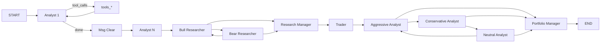
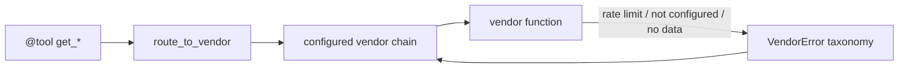

# TradingAgents 架构

文档优先级：**代码 > [PROJECT.md](PROJECT.md) > 本文 > 专题文档 / [Tech Library](tech-library/README.md)**。

最后更新日期：2026-10-14

本文记录当前仓库的真实编排、数据流、状态模型和扩展点。易变清单（模型 ID、供应商默认值）以源码为准，不在此重复维护。

## 系统概览

TradingAgents 是进程内 LangGraph 工作流，不是服务网格。一次运行对应「一个标的 + 一个交易日 + 一组分析师选择」。

```mermaid
flowchart TD
    entry["CLI analyze / predict / web / main.py / TradingAgentsGraph.propagate"]
    cfg["DEFAULT_CONFIG + TRADINGAGENTS_* + set_config"]
    llm["create_llm_client: deep + quick"]
    ident["instrument_identity_for_run"]
    mem["TradingMemoryLog.get_past_context"]
    graph["compiled StateGraph"]
    analysts["Analyst sequence + ToolNodes"]
    debate["Bull / Bear / Research Manager"]
    trader["Trader"]
    risk["Risk debators / Portfolio Manager"]
    signal["SignalProcessor"]
    persist["memory log + results JSON + report tree"]

    entry --> cfg --> llm
    llm --> ident
    ident --> mem --> graph
    graph --> analysts --> debate --> trader --> risk --> signal --> persist
```

## 入口与生命周期

### 可编程

`TradingAgentsGraph`（`tradingagents/graph/trading_graph.py`）是编排门面：

1. `set_config(self.config)`，创建 cache / results 目录
2. `create_llm_client` 各建 deep / quick 客户端
3. `_create_tool_nodes()` 按分析师类别绑定 LangChain `@tool`
4. `GraphSetup.setup_graph(selected_analysts)` 得到未编译 `workflow`
5. `workflow.compile()`；若 `checkpoint_enabled`，在 `begin_checkpoint` 里带 `SqliteSaver` 重编译
6. `propagate(ticker, trade_date, asset_type)`：结算同标的 pending memory → `checkpoint_scope` → `_run_graph`

`asset_type` 默认 `"stock"`；CLI 可按 ticker 识别 `"crypto"`。checkpoint thread id 会折叠分析师选择、辩论/风险轮次和 asset mode（`#1089`）。

### CLI

- 控制台脚本：`tradingagents = cli.main:app`
- 命令：`analyze`（`--checkpoint/--no-checkpoint`、`--clear-checkpoints`）、`predict`、`ingest-news`、`score`（T+1 方向命中率，5 日结算为辅，不下单）、`web`
- 交互选择分析师、供应商、模型、研究深度、输出语言
- 用 `graph.stream` 推进度；成功后可 `write_report_tree`
- Windows 无 console buffer 时给出可操作错误而不是 prompt_toolkit 堆栈（`#1138`）

CLI 与 `propagate` 共用 `begin_checkpoint` / `end_checkpoint`。续跑必须向 LangGraph 传入 `None` 而不是再塞一遍初始 state（`#1249`）。CLI Live 与本机 Web SSE 共用 `cli/run_engine.py` 的 `run_graph_with_events`。

### 本机 Web 操作台

`tradingagents web`（可选 extra `[web]`）在 `127.0.0.1:8000` 提供单用户表单，对齐 CLI analyze 选项。`POST /api/runs` 推 SSE 进度；数据仍走 `route_to_vendor`。默认拒绝绑非 loopback。密钥不进页面。

Docker 用**同一份** `Dockerfile`（阶段 `frontend` = nginx 静态页，`backend` = Python API）和**同一份** `docker-compose.yml`：`web-ui` 与 `web-api` 可一起 `docker compose --profile web up`，也可只起其中一个。宿主机发布 `127.0.0.1:8000`（UI）和 `127.0.0.1:8001`（API）。nginx 把 `/api` 反代到 `web-api`（`set $tradingagents_web_api` + Docker DNS `resolver 127.0.0.11`，避免只 recreate `web-api` 后仍打旧 IP 导致 `/api/options` 502、表单下拉全空），并关闭缓冲以支持 SSE。页面 `boot()` 拉不到选项时把错误写到表单，不要静默空 select。

### Docker

`docker-compose.yml`：默认服务读 `.env`，数据卷挂到 `~/.tradingagents`。`web` profile 起本机操作台（`web-ui` + `web-api`）。`web-api` / `tradingagents` 把 `AKSHARE_BASE_URL` 指到 compose 内 `http://aktools:8080`（不要用宿主机 `.env` 里的 `127.0.0.1`，容器里那是自己）。`ollama` profile 把 `TRADINGAGENTS_LLM_PROVIDER=ollama` 和 `OLLAMA_BASE_URL` 指到 compose 内 Ollama。`akshare` profile 构建 `docker/aktools.Dockerfile`（`akshare>=1.16`，首页 `sitecustomize`），探活打 `/docs`。不要用冻结的官方 `aktools:1.8.95`。豆包：`.env` 设 `TRADINGAGENTS_LLM_PROVIDER=doubao` 后必须 **recreate** `web-api` / `tradingagents`。recreate `web-api` 后重启 `web-ui`，或依赖 nginx 模板里的 Docker DNS 再解析。

## Graph 拓扑

节点与边由 `GraphSetup` + `build_analyst_execution_plan` 生成。



分析师顺序 = `selected_analysts` 顺序。至少选一个，否则 `build_analyst_execution_plan` 抛 `ValueError`。

条件边：

| 源 | 函数 | 目标 |
| --- | --- | --- |
| 各分析师 | `should_continue_<key>` | `tools_<key>` 或 `Msg Clear *` |
| Bull / Bear | `should_continue_debate` | 完整 `DEBATE_PATH_MAP` |
| 三个风险节点 | `should_continue_risk_analysis` | 完整 `RISK_ANALYSIS_PATH_MAP` |

辩论轮次：`count >= 2 * max_debate_rounds` 后进 Research Manager。风险：`count >= 3 * max_risk_discuss_rounds` 后进 Portfolio Manager。`current_response` / `latest_speaker` 前缀决定下一位发言人。

**扩展约束：** 共享 router 的每条边必须映射 router 可能返回的全部目标（`#1088`）。

## 分析师注册表

单一事实：`tradingagents/graph/analyst_execution.py` 的 `ANALYST_NODE_SPECS`。

| key（配置/wire） | 节点名 | 清除节点 | 工具节点 | 报告字段 | 工厂 |
| --- | --- | --- | --- | --- | --- |
| `market` | Market Analyst | Msg Clear Market | tools_market | `market_report` | `create_market_analyst` |
| `social` | Sentiment Analyst | Msg Clear Sentiment | tools_social | `sentiment_report` | `create_sentiment_analyst` |
| `news` | News Analyst | Msg Clear News | tools_news | `news_report` | `create_news_analyst` |
| `fundamentals` | Fundamentals Analyst | Msg Clear Fundamentals | tools_fundamentals | `fundamentals_report` | `create_fundamentals_analyst` |

`social` 键保留是为了旧配置兼容；实现已是 Sentiment Analyst。A 股预取 `get_news` + 雪球/东财股吧帖子/东财人气榜/千股千评（`stock_comment_em` 无参后按六位代码过滤；详情接口带 symbol；人气榜用 `SH`/`SZ`/`BJ` 大写前缀；股吧帖子走东财公开列表，不依赖雪球 cookie）。其它市场仍是新闻 + StockTwits + Reddit。

工具绑定（`TradingAgentsGraph._create_tool_nodes`）：

| 类别 | 工具 |
| --- | --- |
| market | `get_stock_data`, `get_ashare_short_horizon`, `get_ashare_swing_tape`, `get_indicators`, `get_verified_market_snapshot` |
| social | `get_news`（遗留；当前 Sentiment 路径到不了这个节点） |
| news | `get_news`, `get_global_news`, `get_insider_transactions`, `get_macro_indicators`, `get_prediction_markets` |
| fundamentals | `get_fundamentals`, `get_balance_sheet`, `get_cashflow`, `get_income_statement`, `get_insider_transactions` |

工具绑定：

- Sentiment Analyst **不** `bind_tools`。它在 node 内预取 `get_news.func`；A 股再拉 `fetch_a_share_sentiment`，其它市场拉 `fetch_stocktwits_messages` / `fetch_reddit_posts`，然后走结构化 `SentimentReport`。`tools_social` 因此空转，条件边总是进 Msg Clear Sentiment。
- News Analyst 的 `bind_tools` 是 `get_news` / `get_global_news` / `get_insider_transactions` / `get_macro_indicators` / `get_prediction_markets`。提示词要求 `get_news` 为主。价量 Tape 窗口下：`half_month` 拉 15 日历日、`half_year` 拉 180 日历日；否则覆盖过去一周。`get_global_news` 是国内政策（新闻联播、人民日报、新华社财经、中国经济网、中新网财经、央视新闻、中国政府网、中国人民银行、财政部、国家发展改革委、国家统计局，以及财联社等快讯）加海外 Serper Google Search（含 X/YouTube/Meta 公开摘要），只引用明显影响该标的或 A 股交易时段的条目。`get_insider_transactions` 对 A 股是增减持 / 龙虎买卖席位 / 大宗（`akshare_flow.py`，`date<=as-of`），对美股仍是 Yahoo/Alpha Vantage。FRED / Polymarket 可选，未明显影响该代码则不要引用。Bull / Bear / 风险读 `news_report` 时标成个股新闻报告，不是 world affairs。
- Fundamentals Analyst 同样 `bind_tools(get_insider_transactions)`，与 ToolNode 对齐。

新增分析师必须同时改：specs、工厂、tool node、`should_continue_*`、CLI `ANALYST_MAPPING` / `REPORT_SECTIONS`、以及对应测试。若走工具循环，`bind_tools` 与 ToolNode 必须同一组工具。

## 状态模型

`AgentState`（`MessagesState` 子类）是图状态，不是 ORM。

顶层字段：

- 运行身份：`company_of_interest`, `asset_type`, `instrument_context`, `trade_date`, `sender`。`instrument_context` 在开跑时由 `instrument_identity_for_run` 生成：A 股是 AKTools 简称 + 句法板型/交易所 + as-of 涨跌停幅度（无公司名也不编造）；其它市场仍是 Yahoo `info`。
- 分析师报告：`market_report`, `sentiment_report`, `news_report`, `fundamentals_report`。价量 Tape 预取写入报告树 `swing_tape`（`1_analysts/swing_tape.md`），不是图状态字段。
- 研究：`investment_debate_state`（`InvestDebateState`）, `investment_plan`
- 交易：`trader_investment_plan`
- 风险：`risk_debate_state`（`RiskDebateState`）, `final_trade_decision`
- 记忆：`past_context`

初始态由 `Propagator.create_initial_state` 填空报告和空辩论结构。

结构化输出（Pydantic，`agents/schemas.py`）只用于决策代理和 Sentiment Analyst：

- `ResearchPlan` → `investment_plan` / debate `judge_decision`
- `TraderProposal` → `trader_investment_plan`（保留 `FINAL TRANSACTION PROPOSAL: **BUY/HOLD/SELL**` 行）
- `PortfolioDecision` → `final_trade_decision`
- `SentimentReport` → `sentiment_report`

渲染函数把实例变回下游已消费的 markdown。调用模式集中在 `agents/utils/structured.py`：先 `with_structured_output`，失败则 free-text，管道不阻塞。

5 档评级单源：`agents/utils/rating.py` 的 `RATINGS_5_TIER`。图信号在无法解析时为 `REVIEW`，不是可交易 `Hold`。

## 数据流与供应商路由



`interface.py` 要点：

- 类别：`core_stock_apis`, `ashare_tape`, `technical_indicators`, `fundamental_data`, `news_data`, `macro_data`, `prediction_markets`
- 供应商：`yfinance`, `alpha_vantage`, `akshare`（AKTools HTTP 或 pip extra）, `google`（Serper Google Search / News RSS）, `fred`, `polymarket`
- `tool_vendors` 覆盖 `data_vendors`
- 配置字符串即解析链；`"default"` 才用该方法全部已注册供应商
- **不会**把用户没选的供应商悄悄加进去
- 价格 / 指标 / 基本面：first-success fallback。默认 `core_stock_apis` / `technical_indicators` / `fundamental_data` 为 `"akshare,yfinance"`：A 股先打 AKTools 东财日线，失败再腾讯 `stock_zh_a_hist_tx` / 新浪 `stock_zh_a_daily`；三表走 `akshare_fundamentals`（东财 `SH601061` 报告期 → 新浪 `stock_financial_report_sina` → 东财年度），只保留报告日 `<= as-of`。`get_fundamentals` 简介只打 `stock_individual_info_em`（`symbol` / `stock`），失败保持空，不用 `stock_info_a_code_name` 全 A 代码表。非 A 股 `NoMarketDataError` 后走 yfinance。A 股 ticker 的 yfinance 实现直接 `NoMarketDataError`，不发 HTTP。
- `get_ashare_short_horizon`：类别 `ashare_tape`，默认仅 `akshare`。给 Market Analyst 的 A 股次日（T+1）与 5–20 日 tape：前复权 OHLC、未复权额/量/换手、涨跌停旗标、10/20/30% 板限制、沪深300/创业板、涨停/跌停家数、连板高度、北向（as-of 之前的已公布会话）、龙虎榜买卖席位与金额（as-of 盘后）、解禁窗口、仓库公告二元旗标、静态行业指数相对强弱、最多两个国内商品合约以及最多两个外盘（`match_exposure`，先具体后宽：601061 有色 → 沪铜/沪铝 + LME/COMEX 铜；能源金属 → 碳酸锂而不是沪铜；钢铁 → 铁矿 + SGX；饲料 → 豆粕 + CBOT；白酒/银行可只有行业指数）。行业指数 `sh000819` 空再试 `000819`；国内新浪期货空再试 `futures_hist_em`；外盘 `futures_foreign_hist` 空再试东财中文名（`LME铜` / `LME镍` / `SGX铁矿石`）。日线/指数/分钟/龙虎：东财失败再腾讯或新浪。**当日 live as-of** 附加公开最新价（东财盘口 → 雪球 → 腾讯分钟）；涨停池 live 空可用新浪 spot 近似并标记 `market_breadth_source`。live 且仓库空时事件旗标一次性 `ingest_news`。历史 as-of 不得读当日快照、今日全市场表、as-of 之后的期货 K（含外盘），也不得 ingest。不是估值模型，也不是委托，也不是布局画像。同一条 tape 末尾有确定性 `Playbook stance (T+1)`（`ashare_playbook.py`：上证+深证 A 指成交额、昨日涨停溢价、涨跌停家数、银行指数相对沪深300、换手/一字/T/炸板、近端涨停次数）。`t1_bias` 只取 BUY/HOLD/SELL。Market Analyst 把该段保留进 `market_report`；Research Manager、Trader、Portfolio Manager 用 `enforce_t1_bias` 把评级标签对齐到这一行（无该行则不改，避免误伤美股）。容错低、一字/T、炸板、7% 观察区、坏公告/ST/近 5 日解禁都不给方向性 BUY。不扫涨速榜，也不把结论写成十分钟卖出。未配置 AKTools HTTP（`AKSHARE_BASE_URL`）且未安装 extra 时该**可选类别**降级为 `DATA_UNAVAILABLE`
- `get_ashare_swing_tape`：同一 `ashare_tape` 类别。`half_month`（15 日历日）或 `half_year`（180 日历日）窗口内价量（区间涨跌、高低点、均量、换手分位、涨停天数、相对沪深300）+ 北向窗口合计 + 窗口内增减持/龙虎/大宗 + 同一窗口个股/公告与国内政策新闻 + as-of 前约 250 个日历日的缠论分型/笔/线段/中枢（`dataflows/chanlun.py`，右翼未收盘的分型不算；三类买卖点只作候选）。`date<=as-of`。Web「价量 Tape」页设 `swing_tape_window` 后仍 `POST /api/runs`（强制 News Analyst + ingest）；`run_engine` 预取写入报告树 `1_analysts/swing_tape.md`，`MessageBuffer` live 标题必须登记 `swing_tape`。空机构出手、新闻或缠论 `NO_DATA_AVAILABLE`。News Analyst 按窗口 15/180 日拉 `get_news`，不是固定一周。配置键 `swing_tape_window` / `TRADINGAGENTS_SWING_TAPE_WINDOW`。不要另开行情 HTTP。
- `get_news` / `get_global_news`：**聚合**配置链上每一个成功供应商（带 `## Source: <vendor>`），不是 first-success。默认 `news_data` 仍为 `"akshare,yfinance"`（个股新闻）。`get_global_news` 默认 `tool_vendors` 为 `"akshare,google"`：akshare 是联播 + 财联社/东财/新浪/同花顺/富途快讯（`stock_info_global_ths` / `stock_info_global_futu`；接口缺失则该通道空，不中止）以及 `state_media_news.py` 的国家机关媒体（人民日报、新华社财经、中国经济网/经济日报、中新网财经、央视新闻、中国政府网、中国人民银行、财政部、国家发展改革委、国家统计局；单页失败留空）。新闻联播仍有当天 `news_cctv`，并直接读 CNTV 栏目最近约 40 期，窗口外的期次丢掉。同花顺、富途和上述国家机关媒体写入 `get_news` 时只保留标题或正文提到当前代码或简称的行；`get_global_news` 仍保留未过滤的快讯和机关稿。google 是海外 Serper（`SERPER_API_KEY`）走 Google Search，无密钥时退 Google News RSS，并用 `site:x.com` / `youtube.com` / `facebook.com` / `instagram.com` 补公开帖子摘要。不爬 X/Meta，也不接它们的官方 API。Google 索引没有 as-of vintage，历史运行只复用 `data_cache_dir/news/_global/<as_of>/google_search.json`。akshare `get_news` 东财条目须标题提到该六位代码或股票简称（`stock_news_em` 的「关键词=代码」不够；正文仅出现简称也不够）；正文出现六位代码仍保留。电报仍看标题/正文。巨潮公告仍按代码接口保留。跨渠道 `dedupe_items`，并按日缓存于 `data_cache_dir/news/`（历史 as-of 不可变；当日快照 TTL `news_cache_ttl_seconds`，默认 900s；电报/快讯当日 TTL `news_telegraph_ttl_seconds`，默认 120s）。分析报告再与 `news/_warehouse/*.jsonl` 按 `in_window` 合并后再做同一相关性过滤。A 股 ticker 的 yfinance 个股新闻直接跳过。未安装 `[akshare]` 时 `AkshareNotConfiguredError`，其余已配置源仍可用
- 核心类别：最终仍失败则抛出第一个真实错误
- 可选类别（macro / prediction_markets / ashare_tape）：降级为 `DATA_UNAVAILABLE` 哨兵
- 干净的无数据：返回 `NO_DATA_AVAILABLE: ... Do not estimate or fabricate`

供应商错误只分三类反应：`NoMarketDataError`、`VendorRateLimitError`、`VendorNotConfiguredError`。新供应商抛这些类型（或薄子类），router 不需要新 `except`。

前瞻安全：新闻（含 akshare 东财/公告/联播/快讯/国家机关媒体）、StockTwits、Reddit 共用 `dataflows/date_window.py` 的 UTC 半开窗 `[start, end+1day)`。无日期条目只在窗口触及“现在”时保留。FRED 宏观请求按 as-of 钉 vintage。A 股短线 tape 的日线/涨跌停是收盘后已知、用来预测下一可交易日；北向明细严格使用 as-of **之前**的已公布会话。当日公开最新价只挂在 live as-of 上。

符号：`normalize_symbol` 把券商/MT5 风格映射到 Yahoo（外汇 `=X`、加密 `-USD`、金属期货别名、上海 A 股 `.SH` → `.SS`），只用于 Yahoo 查询。CLI/Web 跑图 ticker（`company_of_interest`）走 `run_ticker_symbol`，保留用户输入的 `.SH`。身份解析：A 股走 `resolve_a_share_identity`（AKTools + `a_share_board_type` / `a_share_exchange_name`），禁止 Yahoo `info`；非 A 股仍 Yahoo。`load_ohlcv`（校验快照与 Yahoo 指标）对 A 股调用 `get_akshare_stock_data`，与 `get_stock_data` 同源。A 股中文新闻走 `a_share_code`；非 A 股对 akshare 立刻 `NoMarketDataError`，好让 yfinance 补上。

路径：写入 cache / checkpoint / results 的 ticker 必须先 `safe_ticker_component`。

## LLM 客户端

`create_llm_client(provider, model, base_url, **kwargs)` 懒加载供应商模块。

分发：

- 原生：`anthropic`, `google`, `azure`, `bedrock`
- 其余：`is_openai_compatible` → `OpenAIClient`（含 openai / xai / deepseek / doubao / qwen / glm / minimax / openrouter / ollama / openai_compatible 等）

交叉 kwargs（由 graph `_get_provider_kwargs` 转发）：`temperature`、`llm_max_retries`、`max_tokens`（Gemini 用 `max_output_tokens`）。供应商思考深度：`google_thinking_level`、`openai_reasoning_effort`、`anthropic_effort`。

能力差异放在 `llm_clients/capabilities.py`，不要在 client 里堆模型名 if。密钥环境名放在 `api_key_env.PROVIDER_API_KEY_ENV`。CLI 下拉目录在 `model_catalog.py`。

Deep 模型给 Research Manager 和 Portfolio Manager；quick 给分析师、研究员、交易员、风险辩手。

## 持久化

| 机制 | 默认位置 | 行为 |
| --- | --- | --- |
| Memory log | `~/.tradingagents/memory/trading_memory.md` | 追加决策；下次同标的用收益+反思结算；历史跑按 `resolution_date` 过滤 |
| News cache | `data_cache_dir/news/<ticker\|_global>/<as-of>/<channel>.json` | 资讯/A 股情绪渠道；历史 as-of 永久复用；当日 TTL `news_cache_ttl_seconds`；电报/快讯当日 TTL `news_telegraph_ttl_seconds`；空结果不落盘 |
| News warehouse | `data_cache_dir/news/_warehouse/<ticker\|_global>.jsonl` | append-only；`item_identity` 去重；查询走 `in_window`；由 analyze、`ingest-news` 写入；live tape 在仓库空时再打一次 ingest（历史 as-of 禁止） |
| Checkpoint | `~/.tradingagents/cache/checkpoints/<TICKER>.db` | 可选；成功后清除；ticker 经 `safe_ticker_component` |
| 状态 JSON | `results_dir/<safe_ticker>/TradingAgentsStrategy_logs/` | 每次 `propagate` 写 `full_states_log_<date>.json` |
| 报告树 | `reporting.write_report_tree` | `results_dir/reports/<ticker>_<stamp>/`：`1_analysts` … `5_portfolio` + `complete_report.md` + `run_meta.json`。Web `GET /api/runs/latest` 按 mtime 读最近一棵树（可选 `?ticker=`）。CLI Live / Web 不再写进程 cwd 下的 `reports/` |

环境覆盖：`TRADINGAGENTS_MEMORY_LOG_PATH`、`TRADINGAGENTS_CACHE_DIR`、`TRADINGAGENTS_RESULTS_DIR`。

收益/反思：`_fetch_returns` 用规范化符号 + `benchmark_map`（或 `benchmark_ticker`）。A 股走 AKTools 日线/指数（`realized_holding_returns`），不打 Yahoo；`.SH` / 北交所按 `a_share_code` 选基准。持有窗未走完则保持 pending（`#1169`）。只结算当前 ticker 的 pending。`tradingagents score` 以 T+1（as-of 收盘到下一根，`next_session_raw_return`，不要求指数）为主、已结算 5 日 raw 为辅（BUY 看收益>0，SELL 看收益<0；Hold 不计）。

## 配置模型

单源：`tradingagents/default_config.py` 的 `DEFAULT_CONFIG`。

`_ENV_OVERRIDES` 把 `TRADINGAGENTS_*` 映射到已有键，按默认值类型 coerce；非法布尔/数字在启动失败。`dataflows.config.set_config` 对 dict 键一层 merge，标量替换。

新增可环境覆盖的配置：只加 `_ENV_OVERRIDES` 一行，不要改各入口脚本。

## 扩展点

1. **分析师** — 注册 spec + 工厂 + tools + conditional + CLI 映射 + 测试。
2. **数据工具** — `@tool` 只调 `route_to_vendor`；在 `VENDOR_METHODS` 登记实现。
3. **供应商** — 新模块 + 错误类型 + 类别配置；可选类别列入 `OPTIONAL_CATEGORIES`。
4. **LLM 供应商** — factory 分支或 OpenAI-compatible registry + key 映射 + capabilities + catalog。
5. **结构化代理** — schema + render + `bind_structured` / `invoke_structured_or_freetext`。
6. **配置** — `DEFAULT_CONFIG` ± `_ENV_OVERRIDES`。
7. **本机 UI** — `web/` 包 `run_graph_with_events`。当天沪深主板筛选是 loopback `GET /api/screen`，计算在 `dataflows/ashare_screen.py`。东财现货失败改新浪，新浪再空改腾讯现货；行业板失败改同花顺一览。仍只留主板。涨幅表在日K上面，避免空图把表格顶出第一屏。点一行的日K走 `GET /api/screen/bars`，不是对外行情 API，也不自动开跑。已落盘报告用 `load_latest_run`，不要另起数据库。

## 明确不存在的层

本仓库没有：

- 对外 SaaS / 行情数据 OpenAPI / 多用户 Controller
- 领域 Service 单例或仓储层
- ORM / 迁移
- MQ consumer / producer
- cron / celery 任务（`ingest-news` 是一次性 CLI，不是进程内调度器）

本机 `web/` 操作台不是上述任一层。不要按其它后端项目的分层往这里塞模块。若未来要加对外 API 或队列，先写确认方案并归档 Tech Library。
