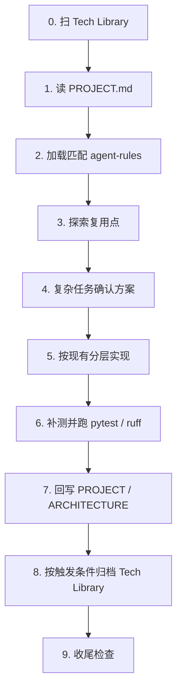

# 跨工具开发自闭环

- 日期：2026-09-05
- 状态：done
- 来源：plan
- 原链接：
- 关联模块：docs/、`.cursor/`、`.claude/`、`.agents/`、`AGENTS.md`、`CLAUDE.md`、README.md
- 回写文档：docs/PROJECT.md, docs/ARCHITECTURE.md, docs/tech-library/README.md, README.md
- 替代关系：无

## 背景

仓库原先只有面向用户的研究 README 和 CI，没有给 Cursor / Claude Code / Codex 共用的开发入口。多工具并行时容易各写一套分层假设（HTTP API、MQ、ORM），与本仓库的 LangGraph 进程内架构冲突。

## 确认方案

1. 以**当前代码**为最高优先级事实，建立 `docs/PROJECT.md` + `docs/ARCHITECTURE.md`。
2. 规则正文只维护在 `docs/agent-rules/`；各工具目录只放适配器，要求读取对应 canonical 文件。
3. 三套 `project-dev-loop` Skill 使用同一 `name`、`description` 和十步流程，不复制易变模块/路由/模型清单。
4. Tech Library 归档已确认方案；本文件是该体系的首条记录。
5. 本阶段不改 GitHub Actions、不新增 PR Template / CODEOWNERS / Branch Protection。闭环靠文档、Skill、Rules 和代码评审。

## 落地调用链

## 分层映射（相对通用后端模板的改判）

本仓库没有 HTTP API、领域 Service、ORM、MQ。规则文件名保留用户要求的一组，但正文按真实切分：

| 规则文件 | 映射到的真实层 |
| --- | --- |
| api-layer.md | `dataflows` 供应商路由 + LangChain `@tool` |
| service-layer.md | `graph` 编排 + `agents` 工厂 + CLI |
| model-layer.md | `AgentState` / Pydantic schemas / LLM catalog |
| mq-consumer.md | **层不存在**；禁止无方案引入 |

## 验收

行为未补测、文档事实未同步、应沉淀方案未归档时，不得声称完成。
